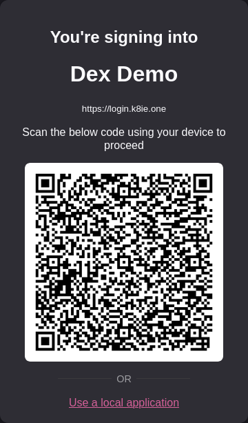

The corporate world realized a long time ago that passwords are obsolete. Unfortunately, FOSS OIDC providers don’t seem to have gotten the memo, and Linux is being left in the dust.

Thankfully, Quorra is here to solve this!

You've probably seen a similar login page at some point. Discord, Steam, various banks, etc. They all have systems where you can use their app to sign in without touching the keyboard.

Quorra brings the same experience to your OIDC compatible apps.

## The situation

At the time of writing I couldn't find a FOSS OIDC provider that is both simple to deploy and offers passwordless user authentication -- without relying on proprietary components or dedicated hardware -- and while offering multi-device support.

That was a mouthful...

Okay, let's break it down. My requirements for a good modern authentication system are:

1. FOSS - fully auditable source code for **all components involved**, including the authenticator application
2. Passwordless - passwords [have](https://www.cnbc.com/2017/10/03/yahoo-every-single-account-3-billion-people-affected-in-2013-attack.html) [their](https://nordpass.com/most-common-passwords-list/) [issues](https://www.cpomagazine.com/cyber-security/new-disney-plus-streaming-service-hit-by-credential-stuffing-cyber-attack/) and are cumbersome to use securely
3. Multi-device - the method has to adapt to **you**, you should have the ability to use the method **anywhere** without having to carry around a specific device
4. Simple to deploy - suitable for self-hosters looking for a better way to sign in

## Why not passkeys

The closest solution to what I'd like to achieve are [passkeys](https://passkeys.io/). But passkeys come with their own set of issues - especially on Linux, with multi-device setups, and with staying free of proprietary implementations.

In the ideal world powered by proprietary magic, you'd use your phone as an authenticator: a website requests your passkey, you get a notification on your phone, you touch the fingerprint sensor, and you're signed in! Perfect -- in theory. The catch is that how the phone communicates the key material to your browser and the relying party is largely a black box, with no fully free software implementations. It's also not truly multi-device: without your phone, you're locked out.

This led me to search for a way to stay in full control of my WebAuthn keys while allowing multi-device synchronization. I came up empty. I thought maybe `gopass` or `pass` would have some kind of answer, and [while there has been some work done](https://github.com/gopasspw/gopass/discussions/2632) to allow `gopass` to store FIDO2 credentials, it still doesn't seem to be usable.

There does seem to be support for storing WebAuthn credentials in KeePass. But I don't use KeePass, and neither do I want to switch to it just to use passkeys.

These sync-based solutions come with a sync issue. Imagine you're at a library computer and you want to use a passkey from KeePass on it to sign into a website. You'd have to somehow get KeePass on the computer and sync your database, giving the untrusted library computer access to your entire password catalog. And don't even get me started on trying to set up `pass` on a library computer...

## What I'm doing about it

That's why I started Quorra.

Quorra aims to be a simple solution to authentication that checks all the boxes.

After adding your device to Quorra, all that is needed to sign in is to scan a QR code and press "approve".



That simple.

You can have multiple devices bound to your Quorra identity. So when you're signing in on your laptop, you **don't need to** reach out for your phone -- you can just click a link that wakes up the app holding your key right on your laptop. No passwords. No phone. No pain.

Of course you can also keep just one device and one key for your account. In that case, you can use a QR code displayed in your browser and scan it using the app on your phone. The **choice is yours**. And yes, it can even be a Linux phone -- you just need a working camera and a QR code scanner like [Decoder](https://flathub.org/en/apps/com.belmoussaoui.Decoder) or [Megapixels](https://gitlab.com/megapixels-org/Megapixels).

The low-level explanation is also fairly simple, the whole thing is based on asymetric cryptography. The app on your device generates a key pair and sends the public key to your Quorra instance during registration. When you're signing in, your device sends a signed message to the server. The server verifies the message and grants you access.

## Call to action

Unfortunately, I don't have infinite time on my hands, but I'm making good progress. I already have a [basic OIDC provider implementation](https://github.com/Quorra-Auth/server), an [Android authenticator app](https://github.com/Quorra-Auth/flare) written in Flutter and another [authenticator app for Linux](https://github.com/k8ieone/voucher) written using GTK4 and Python. I'm also working on setting up a public demo so you can try it and see for yourself.

What I struggle with is **motivation** -- I don't want to pour time into a project that no one ends up using.

If you're interested, please let me know -- in any way. Give the project a [star](https://github.com/Quorra-Auth/server) on GitHub, open an [issue](https://github.com/Quorra-Auth/server) saying you are interested, send me a message on [Matrix](https://matrix.to/#/@k8ie:mcld.eu) or toot at me on [Mastodon](https://toot.mcld.eu/@k8ie). Write me an email (address is visible on my [GitHub profile](github.com/k8ieone)). If you have a few bucks to spare, even a one-time [donation](/#donate) helps. Any of these things go a long way in keeping me motivated to work on Quorra.

## Links

- Quorra server repo: https://github.com/Quorra-Auth/server
- Authenticator for Linux: https://github.com/k8ieone/voucher
- Authenticator for Android: https://github.com/Quorra-Auth/flare
